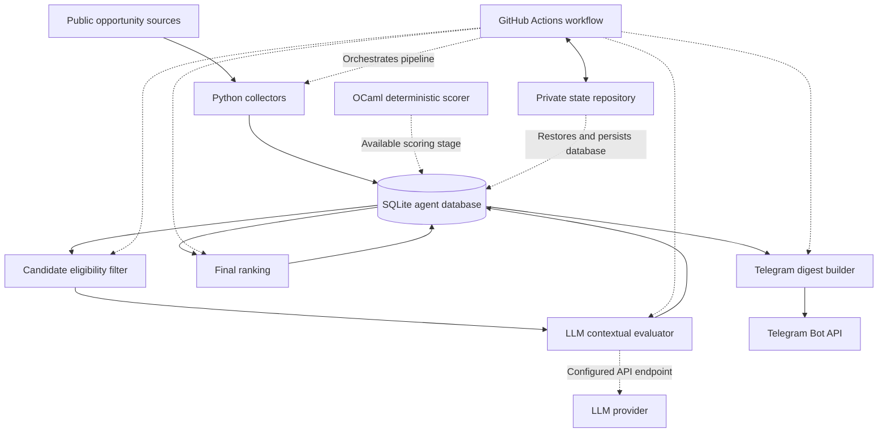

# OCaml Opportunity Agent

> An automated opportunity discovery and ranking system for the OCaml and functional programming ecosystems, with a focus on compilers, programming languages, formal methods, and static analysis.

[](https://ocaml.org/)
[](https://www.python.org/)
[](https://sqlite.org/)
[](https://github.com/features/actions)

**Repository:** [adithn875/ocaml-opportunity-agent](https://github.com/adithn875/ocaml-opportunity-agent)

## Overview

Finding relevant opportunities in the OCaml ecosystem often requires searching across company career pages, community discussions, research institutes, compiler projects, and specialized job boards.

Generic keyword searches can produce noisy results, while relevant opportunities may be scattered across sources that are difficult to monitor consistently.

**OCaml Opportunity Agent** automates this discovery process through a multi-stage pipeline that collects opportunities, filters candidates, evaluates relevance, calculates final rankings, and delivers notifications.

The project combines **Python for collection and orchestration** with **OCaml for deterministic relevance scoring**. An LLM-assisted stage adds contextual evaluation, while a final ranking stage combines technical relevance with practical considerations.

## Key Features

- **Multi-source collection** — gathers opportunities from supported job boards, company pages, and community sources.
- **OCaml-based scoring** — uses a deterministic OCaml scoring component to evaluate relevance.
- **Candidate filtering** — narrows the pool before sending suitable candidates for additional evaluation.
- **LLM-assisted evaluation** — evaluates eligible opportunities using a configurable OpenAI-compatible API.
- **Final ranking** — combines technical relevance and practicality into a single score.
- **SQLite persistence** — stores collected opportunities and scoring data locally.
- **Telegram notifications** — delivers ranked opportunities through Telegram.
- **Automated workflows** — uses GitHub Actions to run the pipeline on a schedule or manually.
- **Persistent workflow state** — supports saving the database in a separate private repository between workflow runs.

## Architecture




### Pipeline stages

| Stage | Responsibility |
|---|---|
| Collection | Retrieves opportunities from configured sources. |
| Persistence | Stores opportunities and relevant metadata in SQLite. |
| Candidate filtering | Selects records eligible for scoring. |
| Deterministic scoring | Calculates relevance using the OCaml scoring component. |
| LLM evaluation | Adds contextual assessment to eligible candidates. |
| Final ranking | Combines technical and practical scores. |
| Notification | Sends relevant results through Telegram. |
| Automation | Runs the pipeline through GitHub Actions and preserves state. |

## Technology Stack

| Technology | Purpose |
|---|---|
| OCaml | Deterministic relevance scoring |
| Python | Collection, filtering, orchestration, and API integration |
| SQLite | Local persistence |
| Scrapling | Web data collection where configured |
| OpenAI-compatible APIs | LLM-assisted evaluation |
| Telegram Bot API | Notifications |
| GitHub Actions | Scheduled and manual automation |
| Git | Version control |

## Ranking Method

The final ranking combines technical relevance with practical suitability.

The current implementation uses the following weighted formula:

$$
\text{Final Score} = 0.7 \times \text{Technical Score} + 0.3 \times \text{Practicality Score}
$$

The weights are defined in the ranking implementation. The final score helps prioritize opportunities that are technically relevant while also considering practical factors.

The LLM evaluation stage is separate from the deterministic OCaml scorer. This separation helps keep the scoring pipeline modular and easier to test.

## Supported Opportunity Sources

The project is designed to collect opportunities from configured sources, including relevant company career pages, community discussions, and specialized job listings.

The exact sources successfully collected depend on the collectors enabled in the current configuration. Some sources may be unavailable temporarily or may change their page structure.

## Project Structure

```text
ocaml-opportunity-agent/
├── .github/
│   └── workflows/
│       └── agent.yml
├── ocaml-scoring/
│   └── ocaml_scoring/
├── src/
│   └── ocaml_agent/
│       ├── main.py
│       ├── candidates.py
│       ├── llm_score.py
│       ├── ranking.py
│       └── score_jobs.py
├── tests/
│   ├── test_candidates.py
│   └── test_ranking.py
├── data/
├── pyproject.toml
└── README.md
```

The tree above highlights key components rather than every file in the repository. Additional collectors, configuration files, and tests may be present.

## Getting Started

### Prerequisites

Install the following tools before running the project:

- Python 3
- OCaml and Dune
- Git
- Access to an OpenAI-compatible API if you want to use LLM-assisted scoring
- Telegram bot credentials if you want to receive notifications

### 1. Clone the repository

```bash
git clone https://github.com/adithn875/ocaml-opportunity-agent.git
cd ocaml-opportunity-agent
```

### 2. Set up Python

Create and activate a virtual environment:

```bash
python3 -m venv .venv
source .venv/bin/activate
```

Install the project dependencies using the dependency configuration included in the repository. For example, if the project is configured for editable installation:

```bash
pip install -e .
```

If the repository specifies a different installation command or dependency file, follow that configuration.

### 3. Build the OCaml scorer

From the repository root:

```bash
cd ocaml-scoring
dune build
cd ..
```

Make sure the OCaml build succeeds before running the full pipeline.

### 4. Configure environment variables

Create a local environment configuration appropriate for your selected LLM provider and notification setup.

For a local OmniRoute configuration, the following settings may be used:

```bash
export LLM_PROVIDER=omniroute
export LLM_BASE_URL=http://localhost:20128/v1
export OMNIROUTE_API_KEY="your-api-key"
export LLM_MODEL="auto/best-reasoning"
```

Replace the example API key with your actual credential. Keep credentials private and never commit secrets to Git.

OmniRoute must be running and reachable at the configured address. If you use another provider, configure the corresponding environment variables supported by the implementation.

Configure Telegram credentials separately if you want to enable notifications.

## Running the Agent

Run commands from the repository root with the Python environment activated.

### Collect opportunities

```bash
PYTHONPATH=src python -m ocaml_agent.main collect
```

### Calculate deterministic scores

```bash
PYTHONPATH=src python -m ocaml_agent.main deterministic-score
```

### Run LLM-assisted scoring

```bash
PYTHONPATH=src python -m ocaml_agent.main score
```

### Preview final rankings

```bash
PYTHONPATH=src python -m ocaml_agent.main rank
```

### Persist final rankings

```bash
PYTHONPATH=src python -m ocaml_agent.main rank --write
```

### Send notifications

```bash
PYTHONPATH=src python -m ocaml_agent.main notify
```

These commands reflect the intended CLI workflow. Run the command's help option if you need to confirm available arguments in your current checkout.

## Automated Execution

The GitHub Actions workflow supports automated execution of the opportunity discovery pipeline.

The workflow can coordinate:

1. Checking out the public project repository.
2. Restoring persistent state from a private repository.
3. Setting up Python and OCaml.
4. Installing dependencies and building the scorer.
5. Collecting opportunities.
6. Filtering candidates and running LLM-assisted scoring.
7. Calculating final rankings.
8. Sending Telegram notifications.
9. Saving updated state.

To enable the workflow in your own fork, configure the repository secrets and variables required by your workflow file. These may include API credentials, Telegram bot credentials, and private state repository access.

Never put secret values directly into workflow YAML or source code.

## Testing

Run the relevant tests from the repository root:

```bash
python -m pytest
```

To run the ranking tests specifically:

```bash
python -m pytest tests/test_ranking.py
```

To run the candidate filtering tests:

```bash
python -m pytest tests/test_candidates.py
```

Tests help verify ranking behavior, filtering rules, and other project logic as the pipeline evolves.

## Design Principles

- **Modularity:** collectors, scoring, ranking, and notifications are separate stages.
- **Deterministic core:** the OCaml scorer provides a distinct, testable scoring component.
- **Practical automation:** GitHub Actions reduces the need for repeated manual execution.
- **Persistent state:** SQLite and the private state repository support continuity between runs.
- **Safe configuration:** credentials belong in environment variables or secret stores.
- **Incremental development:** new collectors and ranking improvements should be testable independently.

## Roadmap

Potential areas for future improvement include:

- Expanding and improving source coverage.
- Adding regression tests for collectors and parsing changes.
- Improving duplicate detection and data quality.
- Tracking changes in job availability over time.
- Making ranking explanations more transparent.
- Evaluating relevance against manually reviewed examples.
- Improving reliability and observability of automated runs.
- Exploring a user-facing dashboard or subscription-based opportunity feed.

## Why OCaml?

OCaml is particularly relevant to this project because its type system and functional programming model encourage explicit data handling and composable logic.

Using OCaml for deterministic scoring also provides a practical way to explore OCaml in a real software project, rather than limiting it to isolated exercises.

## Contributing

Contributions and suggestions are welcome.

If you want to contribute:

1. Fork the repository.
2. Create a focused feature branch.
3. Make your changes and add tests where appropriate.
4. Run the relevant test suite.
5. Open a pull request describing the change.

For collector changes, consider how the implementation behaves when a source is unavailable or its HTML structure changes.

## License

Check the repository's `LICENSE` file for the applicable license terms.

## Author

**Adith N K**

- GitHub: [@adithn875](https://github.com/adithn875)
- Project: [OCaml Opportunity Agent](https://github.com/adithn875/ocaml-opportunity-agent)

Built as a practical project combining OCaml, Python, automation, and functional-programming opportunity discovery.
